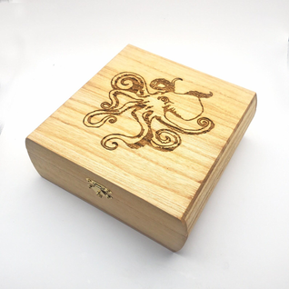
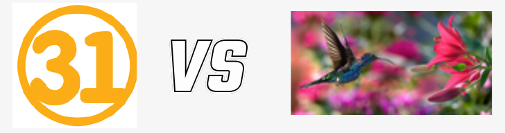

# Digital Citizenship - Ethical AI Use in Design & Technology

**Year 9 | Laser Engraving: From Idea to Wooden Box**

## Your Challenge

Create an original design for your wooden box. You may draw, use Canva or use a school-approved AI tool. AI can help visualise ideas, but you remain the designer. Your image must reflect your thinking and be suitable for engraving.

## 1. Who Is the Designer?

**Student A:** Asks AI for ten random designs, selects one and submits it unchanged.

**Student B:** Begins with a personal idea, writes a detailed prompt, evaluates the result and improves it.

**Discussion:** Who demonstrates more independent thinking? Is an AI-generated image automatically your original work? How might copying an artist's design affect its creator?

**Prompt tip:** Be able to explain your choices and acknowledge any AI assistance.

## 2. Think Critically About AI

AI images can contain mistakes and reinforce stereotypes (Zhou et al., 2024).

Imagine a prompt for "engineers" produces only men.

**Discussion:** Who is missing? What assumptions might viewers make?

**Try it:** Rewrite the prompt to represent engineers from different backgrounds.

**Before using AI:**

- Use only school-approved tools. Do not enter personal details or upload anyone's photo without permission.
- Check image licences and copyright before using other people's artwork or characters.
- Record which parts of your design used AI, and what you changed.

These actions support fairness, transparency and privacy (Commonwealth of Australia, 2023; eSafety Commissioner, 2026).

## 3. Can the Image Be Laser-Engraved?

Compare images from our laser engraving guide:

**Example A:** A simple number versus a detailed hummingbird photograph.

**Example B:** A simple dragon versus a shaded, detailed dragon.

**Discussion:** Which is likely to engrave more clearly? Why?

Look for bold outlines, clear shapes, strong contrast and fewer tiny details. Photographs may require special processing. Check your machine's requirements with your teacher.

**Prompt tip:** Try "bold outlines, high contrast, no gradients".

## 4. Design, Test and Improve

1. **Plan:** Sketch or describe your idea and its meaning.
2. **Create:** Draw, edit in Canva or prompt an approved AI tool.
3. **Evaluate:** Does the result match your idea, respect others' work and suit engraving?
4. **Improve:** Edit the image or refine the prompt. Ask your teacher to approve it before engraving.

## 5. Show Your Design Journey

Keep a short design log:

1. First idea
2. Draft or prompt
3. Problem identified
4. Change made
5. Final design

Explain why each improvement mattered.

**Prompt tip:** Thoughtful decisions matter more than the number of AI prompts.

## Curriculum Alignment

Australian Curriculum Version 9.0:

- **AC9TDE10P02:** Generate, test and refine design ideas, including with digital tools.
- **AC9TDE10K01:** Consider ethical, security and sustainability responsibilities in design practice.

## Reference

1. Australian Curriculum, Assessment and Reporting Authority. (n.d.). *Australian Curriculum, Version 9.0: Design and technologies*. [Australian Curriculum](https://v9.australiancurriculum.edu.au/)
2. Commonwealth of Australia. (2023). *Australian framework for generative artificial intelligence in schools*. [Department of Education](https://www.education.gov.au/schooling/resources/australian-framework-generative-artificial-intelligence-ai-schools)
3. Zhou, M., Abhishek, V., Derdenger, T., Kim, J., & Srinivasan, K. (2024). *Bias in generative AI* [Preprint]. arXiv. [arXiv:2403.02726](https://arxiv.org/abs/2403.02726)
